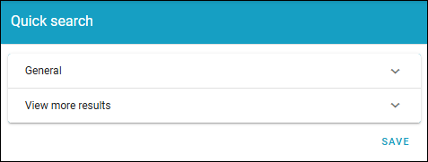
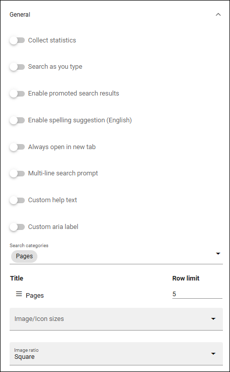
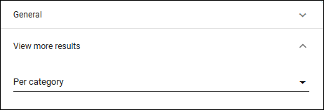
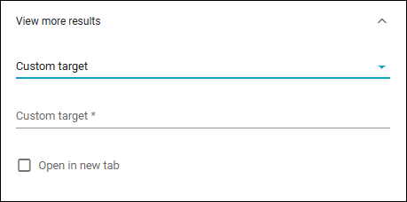

Quick search settings
==============================================

The settings avilable here are valid in all places where quick search is available, both from menus and in the Search block. Images from Omnia 7.12 in this description.

General
****************
The following settings are available here:

+ **Collect statistic**: If search statistics should be collected from quick search, select this option. Search results can then be displayed in Omnia Admin. For more information, see: :doc:`Search statistics </admin-settings/business-group-settings/search/search-statistics/index>`
+ **Search as you type**: The search can be executed either when the user hits enter or ongoing while the user types in the search field. Decide how it should work here.
+ **Enable promoted search results**: If it should be possible for promoted search results to be displayed in quick search, select this option. For more information, see: :doc:`Promoted search results </admin-settings/business-group-settings/search/promoted-search-results/index>`
+ **Enable spelling suggestions (English)**: Select this option to display spelling suggestions in quick search, when users type in the search field. It's the same functionality that Microsoft 365 has. Note that spelling suggestions only works in English. Must be activated in Omnia admin for the option to show up. Not available in Omnia on-prem. 
+ **Always open in new tab**: Available in Omnia 7.12 and later. And yes, you know what it does.
+ **Multi line search prompt**: Available in Omnia 7.12 and later. Per default, the search line is single, with this option, multi lines.
+ **Custom help text**: Available in Omnia 7.12 and later. If a custom help text should be shown on the search line, add it here.
+ Custom aria label**: Available in Omnia 7.12 and later. If a custom aria label should, add it here.
+ **Search categories**: One or more search categories can be added (if more than one is available).
+ **Row limit**: You can set row limit for each search category. Row Limit is the number of objects in a search results "page".
+ **Image/Icon sizes**: Here you can set the size of the icon or image used in the search result list.
+ **Image ratio**: Here you can set the image ratio used in the search result list.

If you make any changes, don't forget to save (the SAVE button is at the bottom).

View more results
******************
Here you can set where the "View more results" link should be placed and if that link should go to a custom target:

"Per category* means after each category, if there are more search results for a category, instead of just at the bottom.

If you select "Custom target", the following is available:

+ **Custom target**: If your organizaton uses another advanced search setup (the View more link goes to an advanced search), you can add the Url here.
+ **Open in new tab**: Select this option if the Custom target link should be opened in a new tab.

