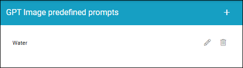
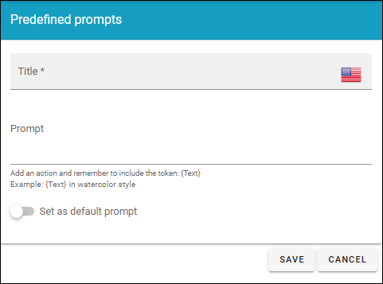

GPT Image predefined prompts 
======================================

Here you can add predefined prompts for GPT Image, authors can use. The business profile feature GPT Image must be active for this option to be available.

You can edit a prompt and delete it, the usual way. When editing, the same options are available as when creating a new prompt, see below.

**A note about deleting prompts**: When you delete a prompt that is set as the default prompt, a message is shown where you can change your mind. When you delet a prompt that os NOT set as default, the prompt is deleted directly. If you delete the default prompt. there is simply no default prompt until you set one.

Creating a new prompt
*************************
Click the plus and use the following settings:

+ **Title**: Add a title for this setting, in any available tenant language.
+ **Prompt**: Add the text for the prompt here. The token - {Text} - must be part of the prompt, see the example.
+ **Set as default prompt**: If this prompt settings should be the default for Dall-E, select this option. **Note!** There can be only one default prompt. if there is already a default prompt, that prompt will automatically be deselected as default. Alos note that it's not required to have a default prompt.

