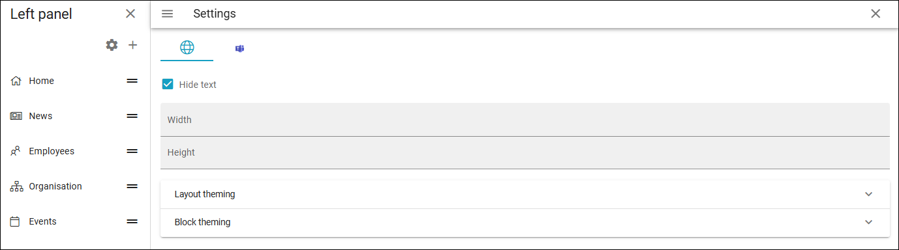

Left panel settings
================================

Available in Omnia 7.12 and later. The app feature "Show navigation bar" must be activated in every app where it will be used.

**Note!** This panel is also called the Everywhere panel.

These settings are available:

You work with these settings the same way as with the mega menu settings for the workspace, see this page: :doc:`Navigation bar </admin-settings/business-group-settings/workplace/navigation-bar/index>`

For some more information about the Evereywhere panel/Left panel, see: :doc:`The Everywhere panel </general-assets/the-everywhere-panel/index>`

