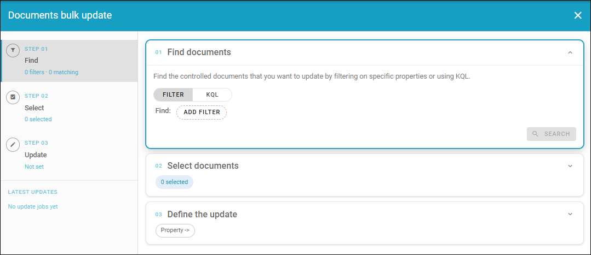
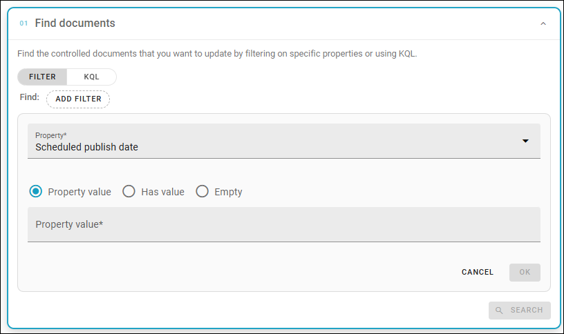
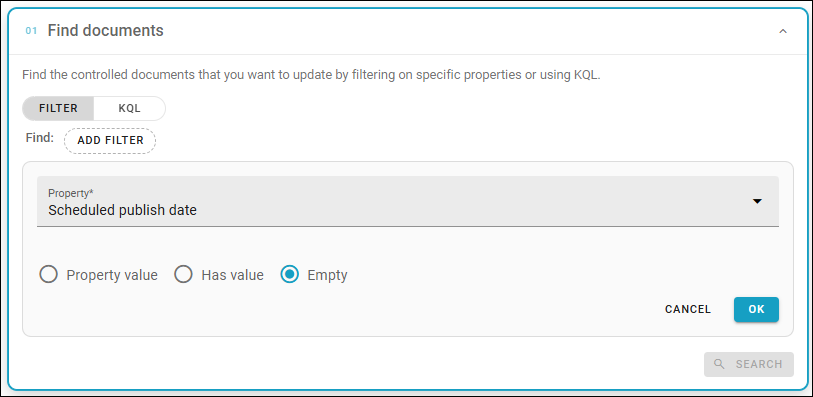
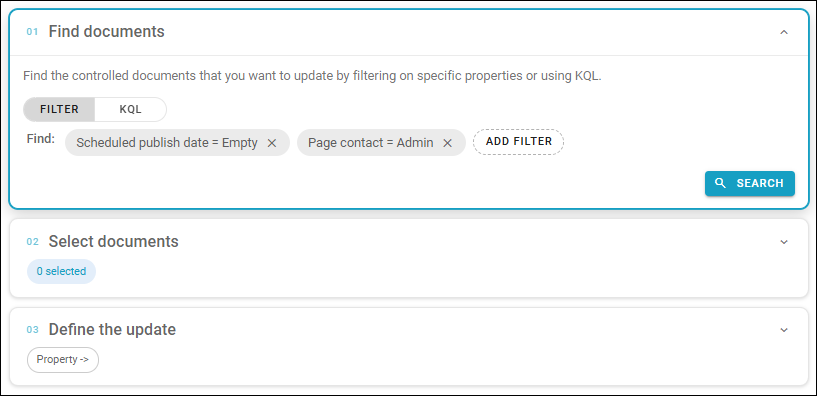
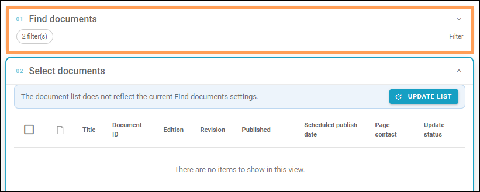
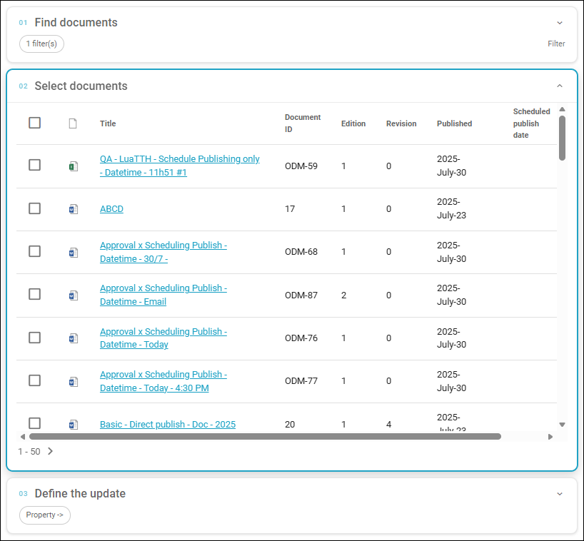
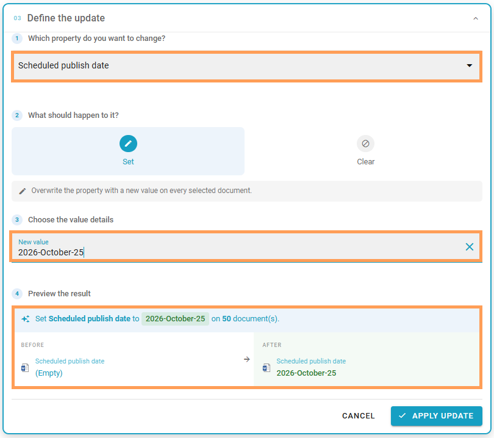
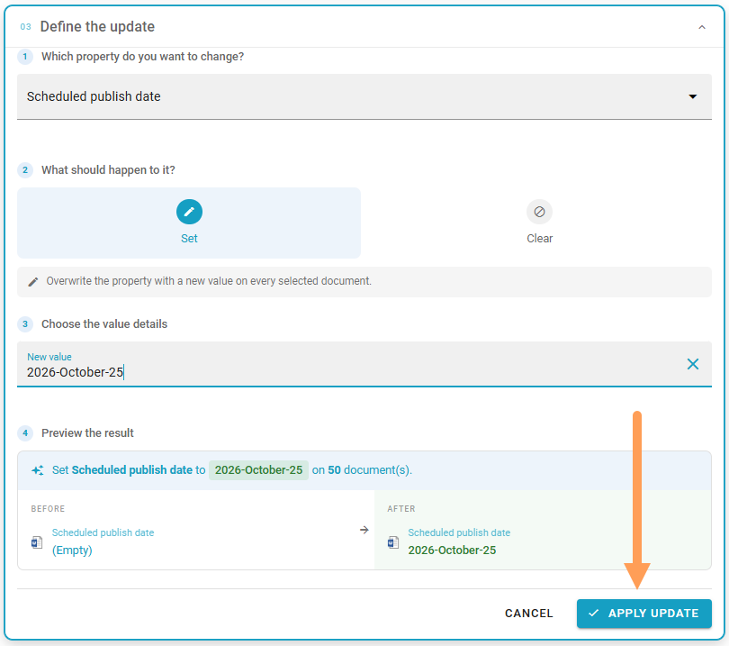

Documents bulk update in Ommnia 7.12
======================================

This page describes how to work with this option in Omnia 7.12 and later. For Omnia 7.11 and earlier, see: :doc:`Documents bulk update </admin-settings/tenant-settings/document-management/documents-bulk-update/index>`

Use this option to bulk update any of the defined document management properties. Note that not all properties can be updated this way. One example is Approver. 

It's possible to replace properties that are no longer present in the system. A good example when this is useful is when a document owner has left the organization and already has been removed from the AD. Also note that Bulk update never updates the template. The republish via Bulk update always uses the current template.

Also note that the user executing the Bulk update must have access to the documents that should be updated. Documents that the user does not have access to are simply not shown in the list.

Some more information about what happens when the changes are are found at the bottom of the page.

The bulk update is organized in three clear steps:

Step 1 - find documents
*************************

You can add a property filter for the documents or add a KQL string. For the KQL option, add the string and click SEARCH.

To add a filter, continue this way:

1. Click FILTER.
2. Click ADD FILTER.
3. Add a property.

+ Use "Poperty value" to add the value to search for.
+ Use "Has value" to simply search for documents that has any value for this property.
+ Use "Empty" for documents that has no value for this property.

For some properties you can search for a text string as well.

4. Click OK.

5. To add more properties for this search, repeat. (To remove a value, just click the x).
6. Click SEARCH.

Step 2 - select documents
****************************
Now a number of documents are listed. If the search didn't find any documents, click FIND DOCUMENTS, do the changes and then click SEARCH again.

When you have found what you're looking for, a list of documents is shown (image from a test enviroment):

7. Select all documents or just some the normal way.

Step 3 - define the update
*****************************

In the final step, define the updates you want to do. In this example we add a scheduled publishing date to all docuemnts that hadn't any, but you can change almost anything for the documents in the list.

Note the preview at the bottom:

If you need to change anything, you can always go back.

When you're done with all settings:

8. Click APPLY UPDATE.

More info about what the update does
*****************************************
This is what happens when the update is finished:

1. Any updated document is republished, the file is overwritten with the existing URL.
2. The edition stays the same, but the revision is increaesed by one.
3, A document history entry is added.

