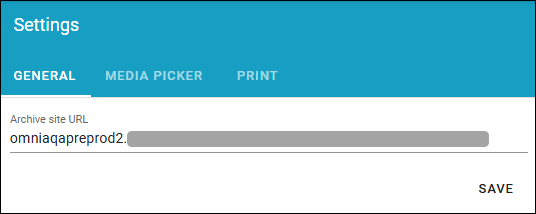
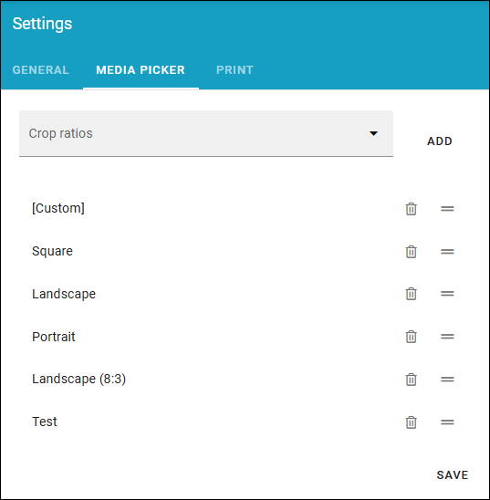
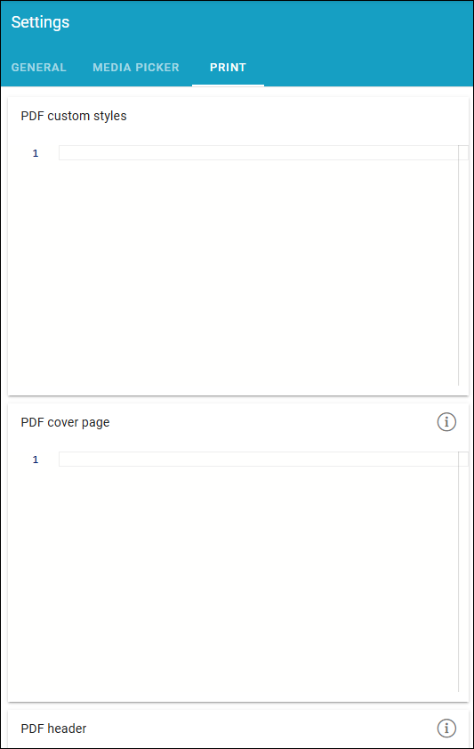

Settings (Process management)
===============================

The following settings are available here (image from Omnia 7.12):

General
****************
In the General tab you can set URL for the archive site.

+ **Archive site URL**: Part of the process management functionality that can be used is an archive site, where a copy of all unpublished processes are placed. The link to the site can be added or edited here.

Media picker
***************
Available in Omnia 7.12 and later. Here you can decide which crop ratios to use, when the media picker is used for a process:

You can choose from the crop ratios that are set up for the tenant. See some more info here: :doc:`Media picker settings </admin-settings/tenant-settings/settings/media-picker/index>`

Print
*******

This is available on the PRINT tab (all settings are not shown in the image):

When a process is printed to a printer or to a PDF file, it's divided into pages and a number of HTML settings are used. Here you can edit these settings if needed.

+ PDF custom styles; Here you can add settings for the text, for example font size.
+ PDF Cover page; If you use a cover page, these settings are for that page. You can use placeholders for dynamic information, see below.
+ PDF Header; Contains settings for the header. You can use placeholders for dynamic information, see below.
+ PDF Footer; Contains settings for the footer. You can use placeholders for dynamic information, see below.

Using placeholders
*********************
For information on using placeholders for printing, see this page: :doc:`Using tokens in Omnia </general-assets/using-tokens-in-omnia/index>`
