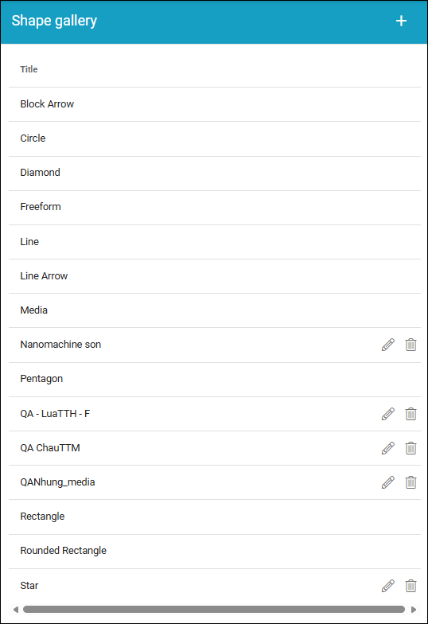
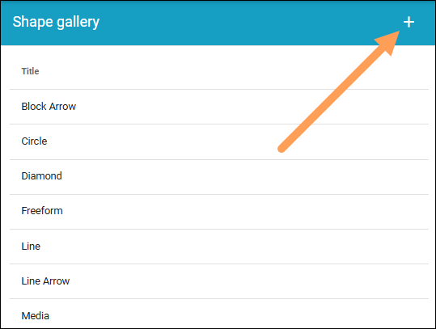
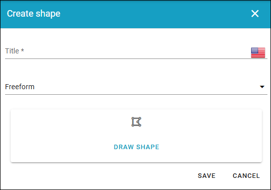

Shape gallery
===============

A number of useful process shapes are installed per default. You can also add additional shapes (image from a test environment in Omnia 7.12).

The default shapes can not be edited or removed, but the ones you or someone else in you your organization add, can, noted by a pen and a dustbin.

Note that when you add a shape to a process template, there's a number of settings you can do for the shape, see the heading "Settings for a shape" on this page: :doc:`The Drawing tab - authoring processes </working-with-processes/authoring-processes/working-with-drafts/drawing-tab/index>`

Adding a new shape
********************
To add a new shape, click the plus.

Use the following settings:

+ **Title**: You can (should) add a title for the new shape, in any or all available languages. Default language for the tenant is mandatory.
+ **Freeform/Media**: Decide how to add the shape; Select "Freeform" to draw the shape, "Media" to upload an image.

Adding a freeform shape
-----------------------
When you have selected "Freeform" do the following:

1. Click "DRAW SHAPE".
2. Click to set the first corner.
3. Move the mouse (do not hold the mouse button down) to the next corner and click.
4. Contintue drawing the shape this way.
5. To finish the shape, move the mouse to the first corner of the shape and click.
6. Click "OK".

.. image:: pm-shape-freeform-new.png

7. Click "Save".

.. image:: pm-shape-freeform-save-new3.png

Adding Media
------------
When you have selected "Media", continue this way:

1. Click ADD IMAGE.

.. image:: pm-shape-media-new2.png

The Media Picker now starts and you use it to add an image as a shape from your computer or from any other source available. For more information, see :doc:`Media Picker </general-assets/media-picker/index>`

2. Use the Media Picker to select an image.
3. Click "OK" in the Media Picker.
4. Click "Save".

.. image:: pm-shape-media-picker-dollar-new2.png

