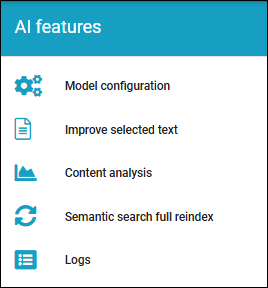

AI features
==================================

The following options are available here (image from Omnia 7.12):

Prerequisite: An Azure Open AI subscription is needed for the AI features to be available in Omnia.

See this page for important information on how to set up AI in your tenant: :doc:`Setup AI </setup/setup-ai/index>`

For current model IDs and deployment recommendations, see: :doc:`Recommended AI models </setup/recommended-ai-models/index>`

Select section for more information.

.. toctree::
   :titlesonly:

   settings-ai-engine/index
   improve-selected-text-ai-engine/index
   content-analysis-ai-engine/index
   semantic-search-full-reindex/index
   ai-features-logs/index
 
