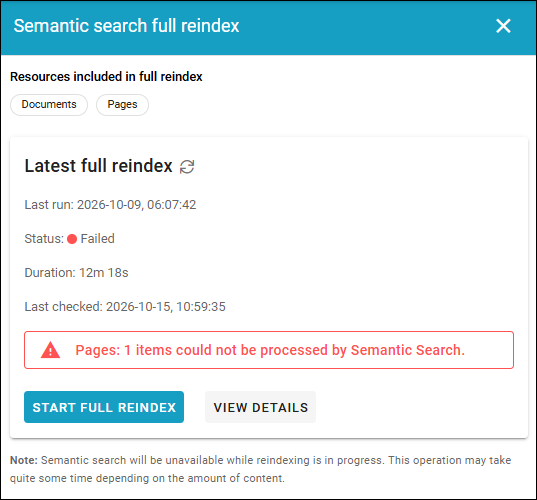

Semantic search full reindex
================================

Available in Omnia 7.12 and later. 

Changes to the embedding model can cause the index structure to change. Use this option to rebuild it (a temorary image from a test environment):
 

**Important!** Note the text at the bottom, that semantic search is not available while the reindexing is in progress.

Use VIEW DETAILS details about the latest resindex.

Some more information can be found on this page: :doc:`Recommended AI models </setup/recommended-ai-models/index>`

