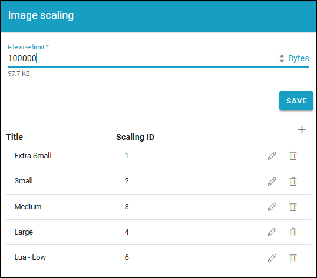
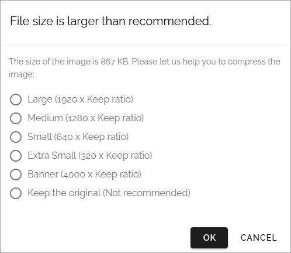
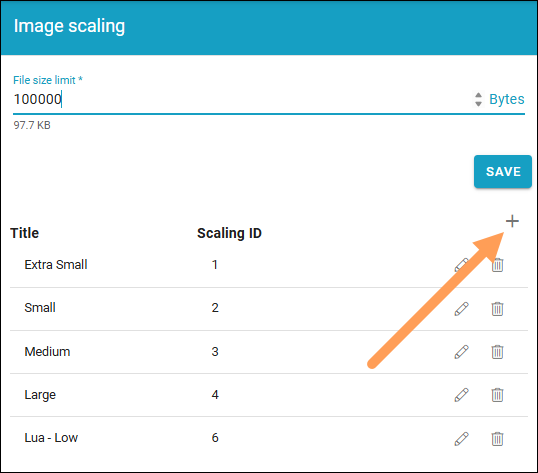
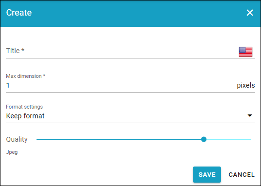

Image scaling settings
======================================

In Omnia 7.11 and earlier image scaling settings is part of the media picker settings. In Omnia 7.12 and later, it's found as a separate option, here. The settings are the same, though.

Here you can set the following:

+ **File size limit**: Set the limit, in bytes, for what is considered to be "too large" for an image in your system. When the file size of an image, selected in the media picker, exceeds this limit, a warning is shown. See below for an example.

The scaling settings listed can be used by authors and editors when an image is added using the media picker.

To edit a scaling setting, click the pen. See *Create a new scaling setting* below for available settings. To remove a scaling setting, click the dust bin.

The warning when an image exceeds the file size limit can look like this:

The author or editor can then decide to make the image smaller in size or add it as it is.

Create a new scaling setting
-----------------------------
To create a new scaling setting, do the following:

1. Click the plus.

2. Use the following settings:

+ **Title**: Add a title for the scaling here. 
+ **Max dimension**: Set the maxumim size in pixels here.
+ **Format settings**: You can choose to keep the original file format or convert to Jpeg.
+ **Quality**: Use the slider to set the quality level for the scaling.

Don't forget to save when you're done.

