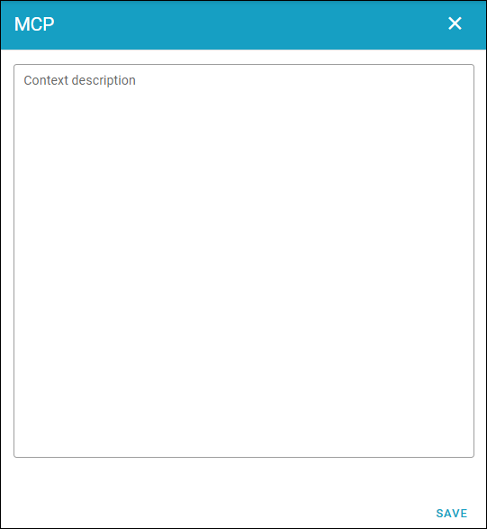

MCP context description
================================

Here you can add and edit a context description for the tenant.

See more information about how you can use this on: :doc:`MCP context for the tenant </mcp/examples/mcp-tenant-context/index>`

More information about how to set up and use MCP in Omnia, is found on this page: :doc:`MCP client integration </mcp/index>`

