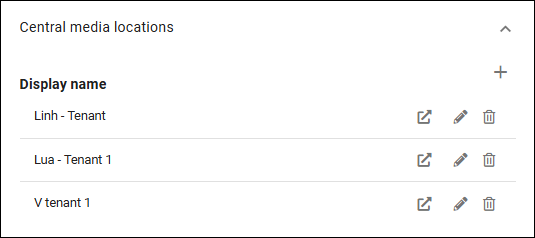
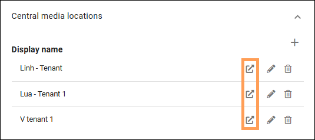
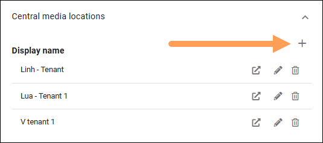
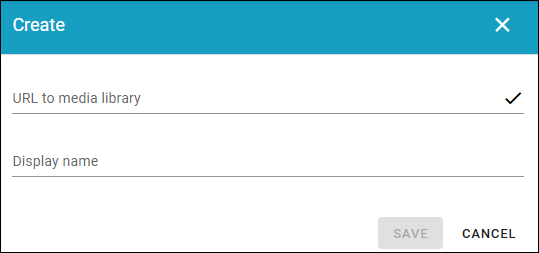
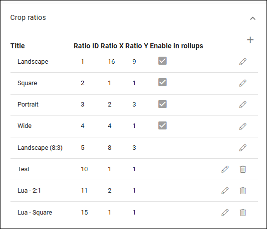
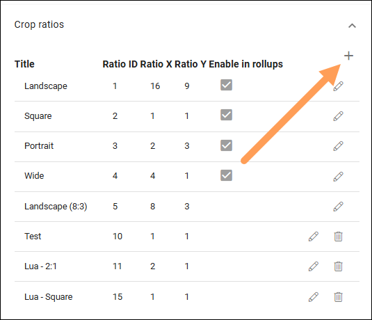
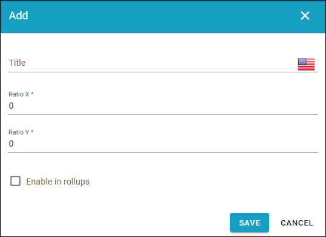
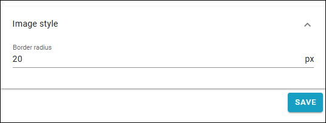

Media picker settings in Omnia 7.12
======================================

**This page is just started. More infor will be added soon.**

Media picker settings, and other media settings have been reorganized in Omnia 7.12 and later, see below.

For media picker settings in Omnia 7.11 and earlier, see: :doc:`Media picker settings </admin-settings/tenant-settings/settings/media-picker/index>`

**Just work material from here. Will be edited soon*:

Central media locations
*************************
You can set central image locations for the editors to use through the media picker. One or more locations can be set up in the list (image from a test environment):

Click the pen to edit the settings for a central image location, or click the dust bin to delete it.

You can also go to the central media location from here, to handle the images there - by clicking this icon:

Also note that all editing and settings for a video must be handled in the SharePoint library, not in the Media Picker in Omnia (as is the case with videos from Microsoft Clipchamp).

Adding a new image location
-----------------------------
To add a new central image location, click the plus:

Use these settings:

+ **URL to image library**: Type or paste the URL here.
+ **Display name**: Add the name to be shown in the lists.

Crop ratios
****************
Set the crop ratios that should be available in the media picker.

Click the pen to edit a crop ratio, or the dust bin to delete it.

The default ratios (Landscape, Square, Portrait, Wide) can not be deleted. A few of the settings can be edited, but ratios can not be changed. 

Create a new crop ratio
-------------------------
To create a new crop ratio, do the following:

1. Click the plus.

2. Use the following settings:

+ **Title**: Add a title for the crop ratio here. 
+ **Ratio X**: Set the horizontal ratio here.
+ **Ratio Y**: Set the vertical ratio here.
+ **Enable in rollups**: Select this option if this ratio should be available to use in block rollups.

Border style
**************
Here you can set a border radius around images:

Notes to users of earlier Omnia versions
******************************************
Image scaling is now found as a separate option in Tenant > Settings. See this page: :doc:`Image scaling in Omnia 7.12 </admin-settings/tenant-settings/settings/image-scaling/index>`

