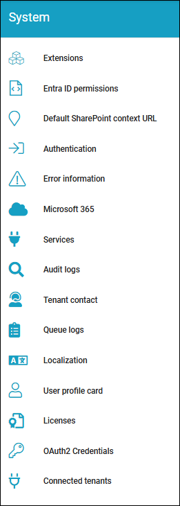

System
=============
Here, the following can be set (image from Omnia 7.12):

Select section for more information:

.. toctree::
   :titlesonly:

   audit-logs/index
   authentication/index
   azure-ad-permissions/index
   default-sharepoint-content/index
   connected-tenants/index
   error-information/index
   extensions/index
   licenses/index
   localization/index
   microsoft-365/index
   oauth2-credentials/index
   services-612/index
   queue-logs/index
   tenant-contact/index
   user-profile-card/index
   
