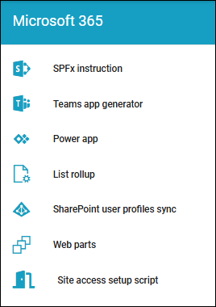

Microsoft 365 settings
==============================================

Here, these settings can be used in Omnia (image from Omnia 7.12):

.. toctree::
   :titlesonly:

   list-rollup-setting/index   
   power-apps-tenant-612/index
   sharepoint-user-profiles-sync/index
   site-selected-setting/index
   spfx-instruction-612/index
   teams-appgenerator-612/index
   system-webparts/index
   

