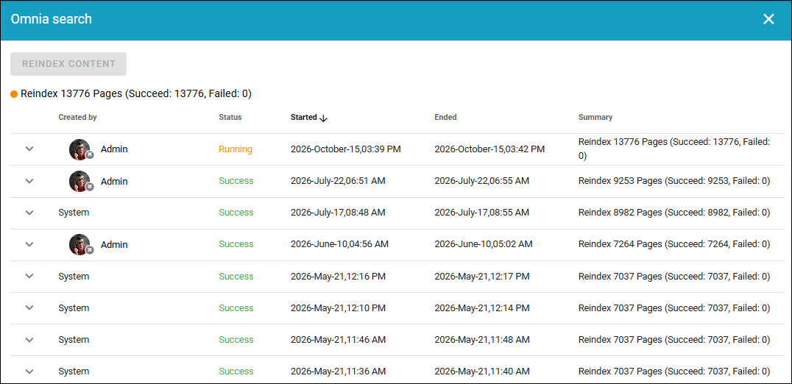
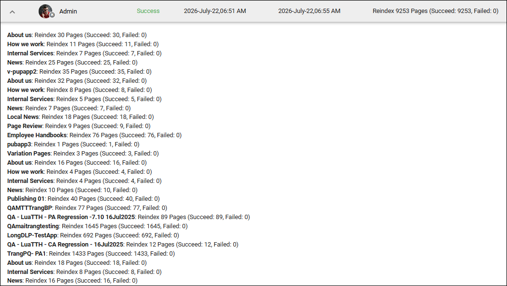

Omnia search - reindex content
================================

Use this Web content management option to make sure all Omnia content in the tenant is indexet for Omnia search. This will most likely need to done now and then. Available in Omnia 7.12 and later.

In the list, you can see info about recent reindexing and if it succeeded or not.

You can expand a post for more information, for example:

To start reindexing, Just click REINDEX CONTENT. When a reindex is running you can see info about the progress.

If the reindex failes, just try again. If you experience repeated failures, report an issue to Omnia support.

