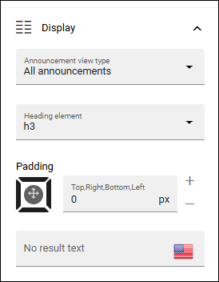
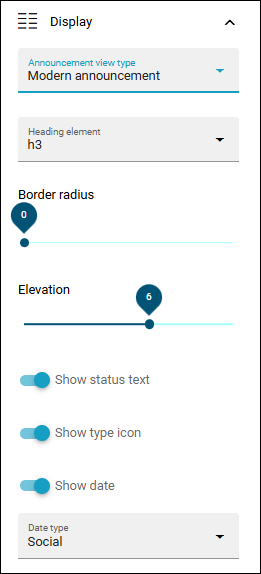
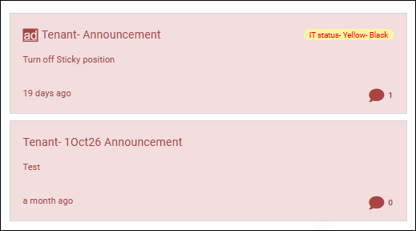
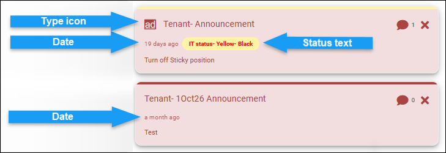
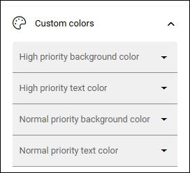

Announcements block in Omnia 7.12
====================================

This page describes the date and time picker in Omnia 7.12 and later. For Omnia 7.11 and earlier, see: :doc:`Announcements block </blocks/announcements/index>`

Announcements are created by administrators and will display important information in the whole tenant, or for a certain business profile. The priority (status) of an announcement can be Normal or High. Announcements can be displayed at the top or in a block, which is what’s described here.

Settings for the block
***********************
The following settings are available for the Announcements block:

.. image:: announcements-settings-v712.png

General
----------------
Here you can set a title for the block, if needed:

.. image:: announcements-settings-general-v712.png

Display
--------
The following settings are available here:

+ **Announcement view type**: You can choose to display all announcements, only high priority announcements or announcements with a modern display. 
+ **Heading element**: You can choose anothert heading element if needed.
+ **Padding**: Use this option to set some padding for the text within the block.
+ **No result text**: If you would like another text to be shown when there's no announcements to show, add it here.

For the modern display, the following settings are available:

Settings for all announcements looks more or less as in earler Omnia versions, for example:

Here's an example for a modern display (from a test environment):

"Border radius" is settings for rounded cornes. "Elevation" is what makes the messsages looks like they are somewhat raised. The rest of the settings are noted in the image above.

Icon types and colors for status are set in Omnia admin.

Custom colors
----------------------
Colors should be set centrally for consistency, but if needed, the following custom colors can be set here:

Layout and Write
*********************
The WRITE TAB is not used here. The LAYOUT tab contains general settings, see: :doc:`General Block Settings </blocks/general-block-settings/index>`

