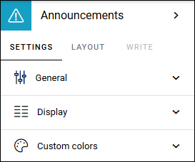
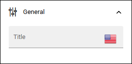

Announcements
===========================================

Announcements are created by administrators and will display important information in the whole tenant, or for a certain business profile. The priority (status) of an announcement can be Normal or High. Announcements can be displayed at the top or in a block, which is what's described here.

An announcement displayed in a block can look like this for the user:

.. image:: announcement-user.png

Settings for the block
***********************
The following settings are available for the Announcements block (image from Omnia 7.12):

General
----------------
Here you can set the following:

Note! In Omnia 7.11 and earlier, there's no Display tab. All display settings are available here, on the General tab.

+ **Title**: A title can be added for the block, if needed.

Display
--------
The following settings are available here in Omni 7.12 and later:

.. image:: announcements-settings-display-v712.png

+ **Announcement view type**: You can choose to display all announcements (meaning both normal and high priority), high priority announcements or modern announcements. Modern announcements are available in Omnia 7.12 and later.
+ **Heading element**: Available in Omnia 7.12 and later. You can choose anothert heading element if needed.
+ **Hide block when no data**: Available in Omnia 7.11 and earlier. As it says, select this to not show the block when there are no announcements to show for the logged in user.
+ **Padding**: Use this option to set some padding for the text within the block.
+ **No result text**: Available in Omnia 7.12 and later. If you would like another text to be shown when there's no announcements to show, add it here.

Custom colors
----------------------
Colors should be set centrally for consistency, but if needed, the following custom colors can be set here:

.. image:: announcements-settings-general-colors-v752.png

Layout and Write
*********************
The WRITE TAB is not used here. The LAYOUT tab contains general settings, see: :doc:`General Block Settings </blocks/general-block-settings/index>`

