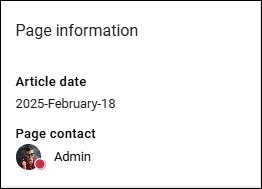
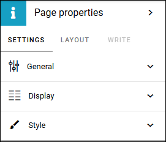
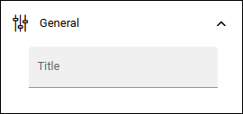
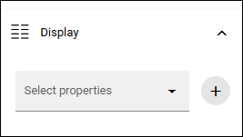
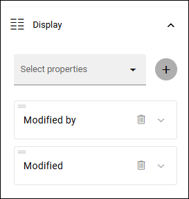
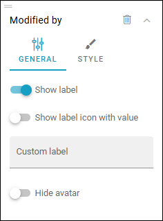
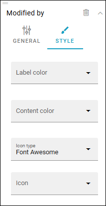
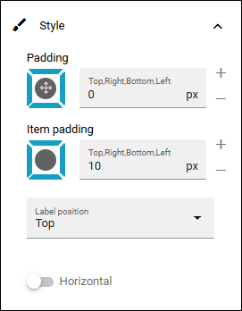
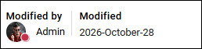

Page properties
===========================================

Use this block to show information about the page. Here's an example:

If the block does not contain any values, it's not shown.

Settings
***********
The following settings are available for the block:

General
------------
Here you can add a title for the block, if needed.

Display
---------
Here you decide what to show in the block.

Open the list, select a property and click the plus. Repeat for each property you would like to add.

Here's an example with two properties:

But that just an example, this block can be used for many purposes.

For each property you add, you can set some options. Expand to set them:

For General Style you can set:

+ **Show label**: Decide to show the property label or not. 
+ **Show label icon with value**: Can be used for some properties, if there is a value (not really applicabale in this example).
+ **Custom label**: Add a custom label here if needed, to be shown instead of the property lable.
+ **Date type**: For date type properties you can choose Default, Classic or Social.
+ **Hide avatar**: For people type properties you can choose to hide the avatar image.

For extra style, some color settings and icon settings are available. Should be self explanatory.

Style
---------
Use the Style tab for these settings:

+ **Padding** You can add some padding around the content of the block, or for each item, if needed.
+ **Label position**: You can set the position of the property at the top or to the left.
+ **Horizontal**: If you want the properties to be shown side by side instead, select this option.
+ **Hide separator**: When you select "Horizontal", you can choose to use a separator line.

Here's an example with the information shown horizontally, with a separator, and with some padding added:

Layout and Write
*********************
The WRITE Tab is not used here. The LAYOUT tab contains general settings, see: :doc:`General block settings </blocks/general-block-settings/index>`
