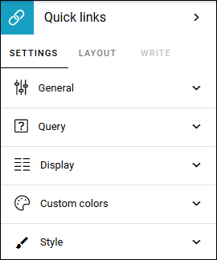
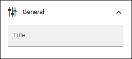
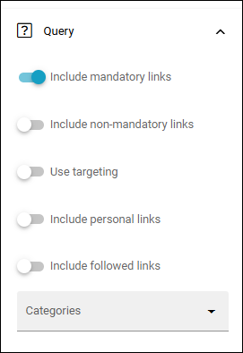
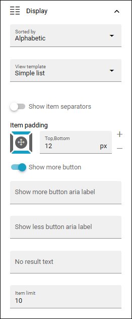
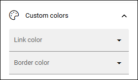
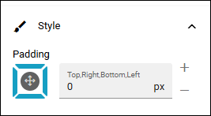

Quick links block for Omnia 7.12
=====================================

Available in Omnia 7.11 and earlier, but differently organized in Omnia 7.12 and later, described here. For Omnia 7.11 and earlier, see: :doc:`Quick links block </blocks/quick-links/index>`

Administrators can add and edit shared links using options in Omnia admin. Links can be shown either for the whole tenant or for a specific business profile. 

You can use this block to show shared links on any page.

Settings
*********
The following settings are available for the block:

General
--------
Here you can add a title for the block, if needed:

Query
----------
Use the Query tab for settings on what to show in the block:

+ **Include mandatory links**: Choose to include mandatory links, or not. 
+ **Include non-mandatory links**: If non-mandatory Links should be displayed, select this option. 
+ **Use targeting**: Select to use targeting (meaning the targeting that was set up for the links in Omnia admin) or not for the links you choose to display here. Effects mandatory links as well. Normally this option should be selected as there are good reasons for the targeting of certain links, but in specialized implementations it is still possible to choose to display all links, targeted or not.
+ **Include personal links**: If the logged in user's personal links (= created by the user) should be displayed, select this option.
+ **Include followed links**: Followed links are non mandatory links that the user has chosen in his or her My links list. If such links should be shown in this block, select this option. 
+ **Categories**: Shared links can be categorized. Select to show one or more categories here. If no selection is made, all categories are shown.

Display
*********
You can set the following for Display:

+ **Sorted by**: Decide how to sort the link list; Alphabetic or Last visited order.
+ **View template**: Select view for the list here; Simple list, App icons, Navigation view or App launcher.
+ **Show item separator**: For a separator between every post, select this option.
+ **Item padding**: You can set some padding around each post here.
+ **Show more button**: To display a "Show more" button at the bottom of each lats page, select this.
+ **Show more/Show less aria label**: If you're using aria labels, add them here.
+ **No result text**: If a custom text should be shown for no result, add the text here.
+ **Item limit**: Set the number of links to be shown per "page" in th list.

Custom colors
--------------
You should primarily set colors centrally but you can change colors for some elements here, if needed:

Style
------
Just the possibility to set some padding for the whole block is available here:

Layout and Write
*********************
The WRITE Tab is not used here. The LAYOUT tab contains general settings, see: :doc:`General block settings </blocks/general-block-settings/index>`

