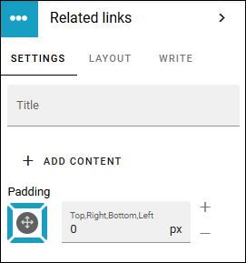
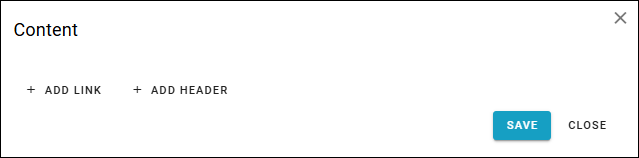
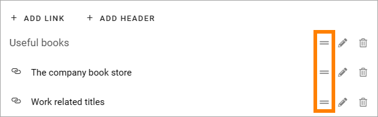
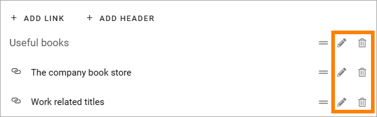
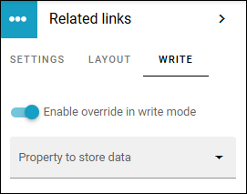

Related links
===========================================

Use this block to add links to related pages or documents in the tenant, or use a custom link to link to any web page. You can also add headings. 

It is possible to add default content to this block and you can set if it should be possible to edit the default content or not. 

If no default content is added, or if editing the default content is allowed, links and headings can be added or edited using Write mode. If default content is added and then locked, nothing can be added to the block.

Block Settings
****************
The following settings are available for the block:

You can add a title for the block if needed, the same way as for other blocks, and some block padding.

You can also click ADD CONTENT to add default content to the block. Also see below.

Add default content
---------------------
When you click ADD CONTENT the the following is shown:

When you click ADD LINK, the Add link general asset is opened. See this page for more information on how to add links: :doc:`Add link </general-assets/add-link/index>`

Adding a header is simple, just click and add.

You can use the WRITE tab to set if editors should be able to edit the default content or not, see below.

Arranging the list
---------------------
When you are done adding links and headings, the list may need some arranging. Use to left-moste icon and drag and drop.

Edit or delete a link or heading
--------------------------------------
To edit a link or heading, or delete it, use the icons.

LAYOUT and WRITE
------------------
The LAYOUT tab contains general settings, see: :doc:`General block settings </blocks/general-block-settings/index>`

Using the WRITE tab you can set the following:

+ **Enable overwrite in write mode**: If it should be possible for editors to edit the default content in the block, this option should be on. If not, click to set it to off.
+ **Property to store data**: Select property from the list. When one block on the page has data connected to a property, that data can be reused in all blocks that uses the same property. Page scoped. Not mandatory.

