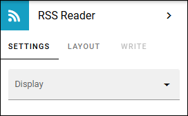

RSS reader
=====================

Using this block, notes from a RSS reader source can be displayed on a page. Users can click the heading of an item to go to the source and read more.

**Note!** The RSS Reader supports RSS 2.0 and Atom 1.0, or newer. RSS notes must also be uncompressed.

Settings
**********
The following settings can be used:

Start by selecting "Display" and the rest of the settings will be shown. 

+ **Display**: Choose "Image on left", "Image on right" or "No image". Note that many RSS Feeds simply do not contain images. In that case all options here will in effect be treated as "No image".

The following settings are available for the RSS views:

+ **Paging**: Select "No paging" or "Classic". Se an important note about paging and Page Size, below. See an example of classic paging below.
+ **Page aize**: If you have have chosen "Classic" above, use this setting to decide the number of items for each page. **Important note**: If you have chosen "No paging" above, here you will set the number of items available in the list, meaning the latest items and no paging even if there are more items available from the source. To display all available items, set this to 0.
+ **Source**: Add the link to the Source here. 
+ **Encoding**: Tells the RSS reader which character set to use when decoding the feed, so characters such as accented letters or non-Latin text display correctly instead of becoming garbled. 
+ **Show title**: To show a Title bar for the RSS list, select this option and add the title in the field shown.
+ **Open in new window**: Here you set what will happen when a user clicks a heading in the list to read more; open in a new window or not.
+ **Show actual day**: To show actual date for an item in the list, select this option. If not selected, an item will just show how much time has passed since the item was published, for example "2 hours ago" or "7 days ago".
+ **Padding**: Padding will often be needed. Set the padding in pixels here.

Layout and Write
*********************
The WRITE Tab is not used here. The LAYOUT tab contains general settings, see: :doc:`General block settings </blocks/general-block-settings/index>`

