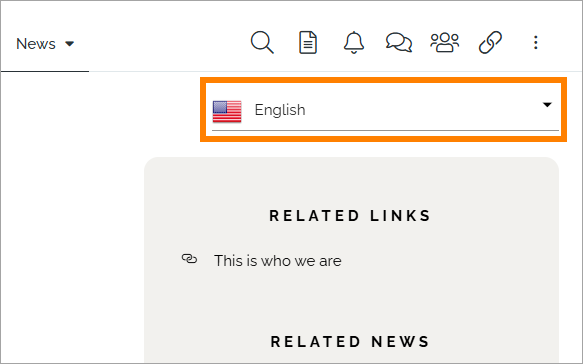
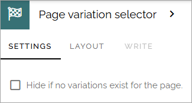

Page variation selector
=========================

Use this block to make it possible for end users to select a variation of the page. For more information about page variations, see: :doc:`Publishing app settings </pages/page-settings/index>`

Here's an example of the block placed in a section at the top of the page, in this case part of the page type:

The block will simply show a list of the available page variations when opened.

Settings
**********
Here you can decide if the block should be hidden if no variations exist for the page.

If the block is part of a page type this setting can't be edited.

Layout and Write
*********************
The WRITE Tab is not used here. The LAYOUT tab contains general settings, see: :doc:`General block settings </blocks/general-block-settings/index>`
