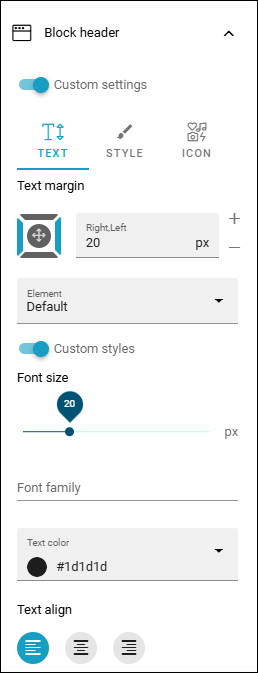

Block header
==============

You can set custom settings for the block headers on this page or page type, by clicking the button.

.. image:: page-toolbar-block-header.png

Then these settings are available:

It's the settings set up in Omnia admin for the business profile. You can edit them for this page if you like. 

See this page for more information: :doc:`Content Header </admin-settings/business-group-settings/settings/block-title/index>`

