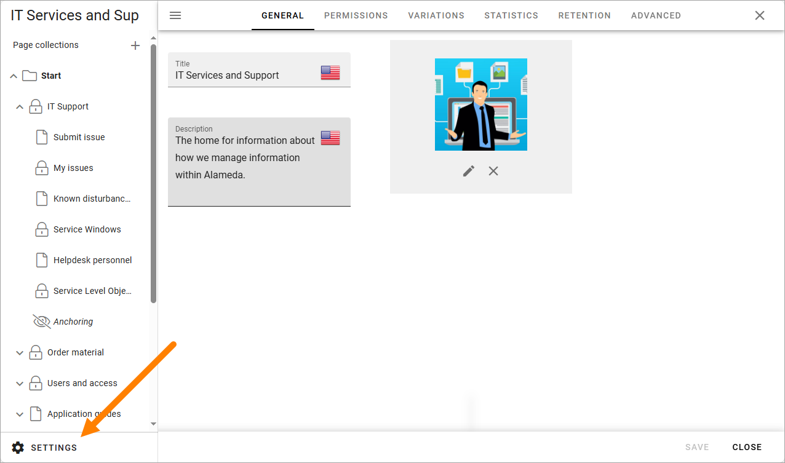
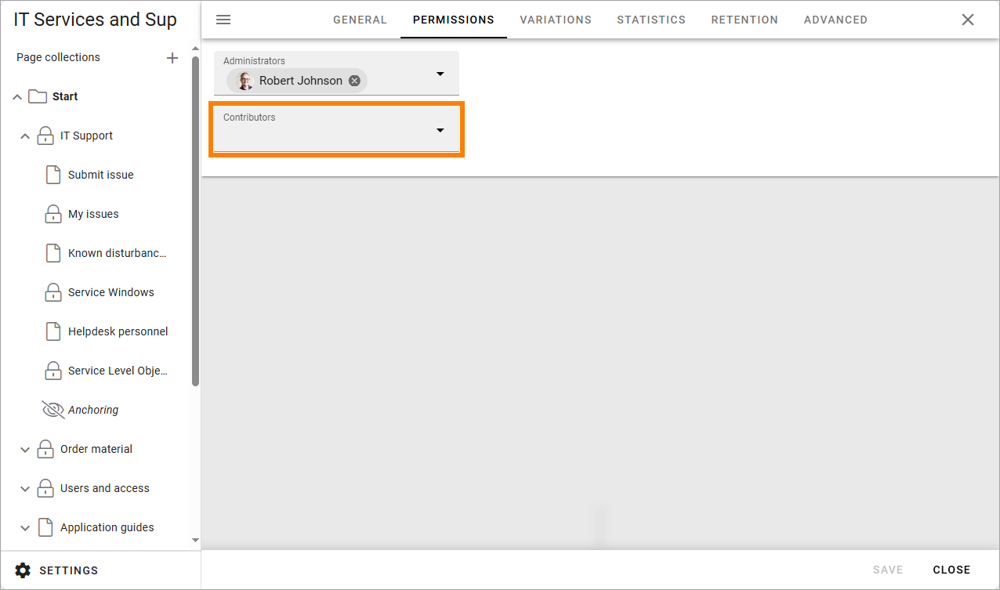
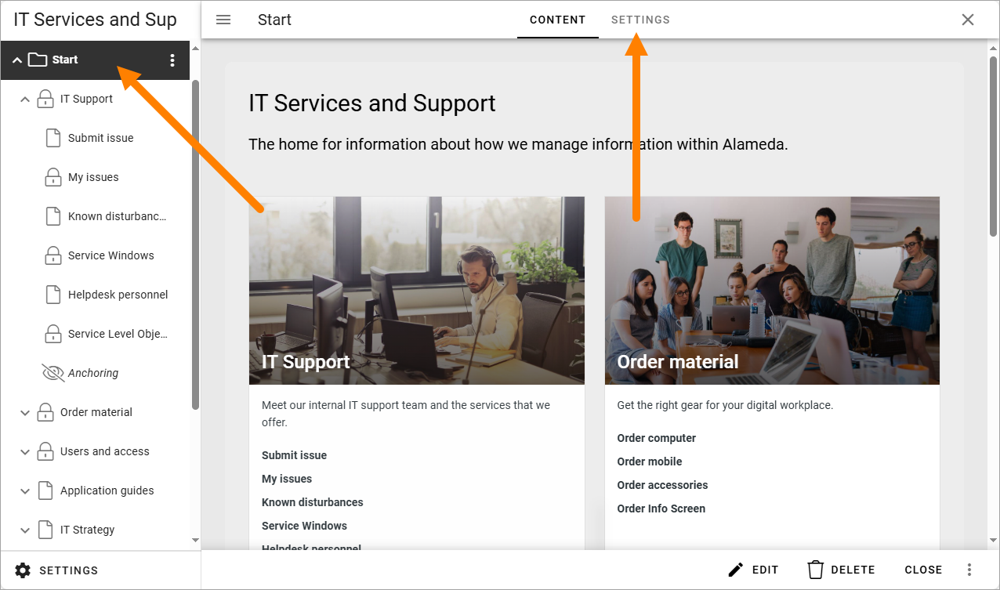
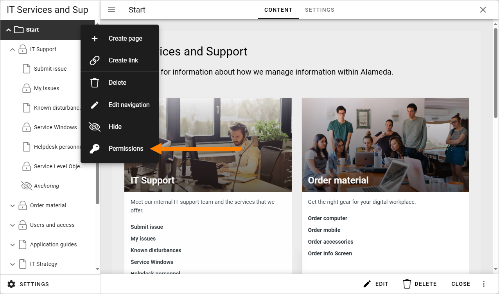
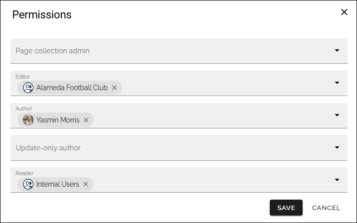

Roles and permissions in Omnia
==================================

This page contains a short overview of roles and permissions in Omnia.

Roles and permissions in Omnia admin
****************************************

Tenant Administrator
----------------------
A tenant administrator can: 

+ Edit all tenant settings in Omnia admin.
+ Add colleagues to various permissions within the tenant.
+ Create business profiles and add business profile administrators.

For information about the different permissions that can be set for the tenant, see: :doc:`Permissions for the tenant </admin-settings/tenant-settings/permissions/index>`

Business profile administrator
--------------------------------
A tenant administrator creates the business profiles needed, and adds at least one administrator for each business profile.

A business profile administrator can:

+ Edit all settings for the business profile, in Omnia admin.
+ Edit permissions for the business profile, including adding and removing business profile administrators.
+ Create publishing apps in the business profile and add publishing app administrators.

For information about the different permissions that can be set for a bussiness profile, see: :doc:`Permissions for a business profile </admin-settings/business-group-settings/permissions/index>`

Roles and permissions in a Publishing app
******************************************

Publishing app administrator
------------------------------
A business profile administrator creates the publishing app and adds at least one publishing app administrator. 

A publishing app administrator can:

+ Edit all settings for the app.
+ Create page collections within the publishing app and add page collection administrators.
+ Edit permissions for a page collection within the app.
+ Create and edit local page types, meaning page types that exists in a page collection in the app only (not tenant page types).
+ Delete a comment in the app (in the Page likes and comments block).
+ Create a form using an action button.
+ Act as a page collection administrator when needed.

The publishing app settings are available here:

**Publishing app contributor**: Contributor permissions is needed for colleagues that should be able to add comments to publishing pages. This permission can be set when editing app permissions:

Roles and permissions in a Page Collection
*********************************************

Page collection administrator
-----------------------------------
Page collection administrators can be added to a page collection by the app administrator. A page collection administrator can:

+ Edit all page collection settings.
+ Edit permissions for the page collection: Administrator, Editor, Author and Reader permissions.
+ Edit the root page of the page collection (a page editor or author can not do that).

The page collection settings are available when the top node in the page collection is selected:

The permissions settings are available here:

And these permissions can be set here:

Note that all permissions for editing and deleting pages and cerating pages and other nodes, are inherited in the page collection, but permissions for specific pages and other nodes can be changed if needed.

Page collection permissions are described on this page: :doc:`General block settings </pages/page-collections/page-collection-permissions/index>`

