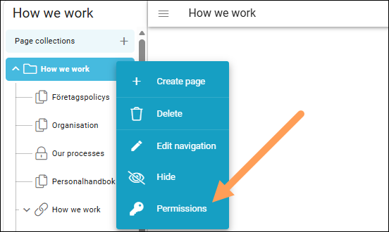
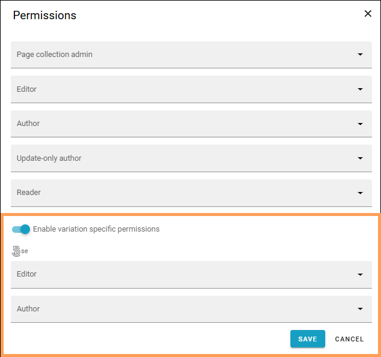
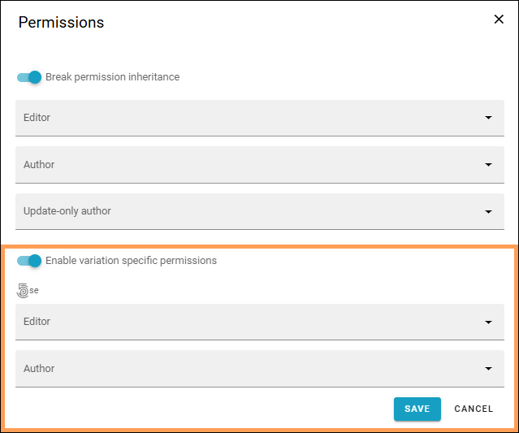

Permissions for variation pages
====================================

A variation page is a copy of a source page that contain some sort of alternative content. It can for example be the source text in another language, but variations can really be used for a lot of purposes.

As a variation is a page, normal permissions for pages within a page collection apply. Colleagues that are permitted to edit the source page, can edit the variations of that page as well, if no specific permissions are set up (see below). Page collection administrators can always edit all pages in a page collection, variation pages included, regardless if how other permissions are set up, as long as inheritance is not broken.

Variation authors can be added to a variation using the publishing app settings, see: :doc:`Publishing app settings </pages/page-settings/index>`

Variation authors for the page collection can also be set the way described here, and if speecific permissions for a variation page is needed, it must be set for the page, as described here.

Variation specific permissions
**********************************
You can set permissions for all variation pages of a certain type in the page collection, this way:

1. Open a page for editing.
2. Select the variation you would like to set permissions for.
3. Select permissions for the page collection.

4. Select "Enable variation specific permissions".
5. Set permissions for editor and/or author for the variation.

6. Save.

Note that the variation you set permissions for is shown, in this example "se" for svenska.

Permission for a specific variation page
---------------------------------------------
If needed, you can set permissions for a specific variation page. An example where this may be needed could be if some information in an employee handbook, for example regarding holidays, differs between countries. 
 
This is how it's set up: 

1. Open the page for editing.
2. Select the variation you would like to set permissions for.
3. Break inheritance.
4. Select "Enable variation specific permissions". 

5. Add editor and/or author permissions for the variation.
6. Save.

Now the variation of this page, can only be edited by the colleauge(s) you have selected.

