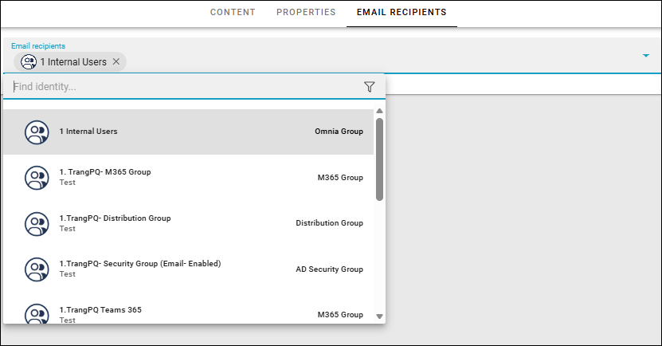

Send page as Email
=============================================

If you should need it, you can send a page through Email. To be able to do so the following must have been done:

+ The option "Enable send as Email" must be activated in the page collection settings.
+ Email recipients must have been added for the page(s) you would like to send. Settings is per page.

**Important note!** If sending as Email is activated, scheduling can't be used.

Every time you publish such a page you will be able to send the page if you want, or just publish without sending.

Information about the page collection settings are described om this page: :doc:`Page collection settings </pages/page-collections/page-collection-settings/index>`

Adding Email recipients
*************************
When sending a page through Email has been enabled, the following is available for each page in the page collection:

.. image:: send-as-email-recipients.png

(If "Enable send as Email" has not been activated, this tab is simply not shown.)

Add all recipient's Emails here, using a people picker (image from a test environment):

Any colleauge or group that has an Email address can be added to this list.

You save by publishing. You can change the recipients anytime.

Sending a page through Email
*******************************
When you have edited a page and publish the changes the normal way, the following is shown:

.. image:: send-as-email-send.png

Choose what you want to do - just publish or publish and send the page through Email.

The page is always sent to all recipients, if you choose to do send.

