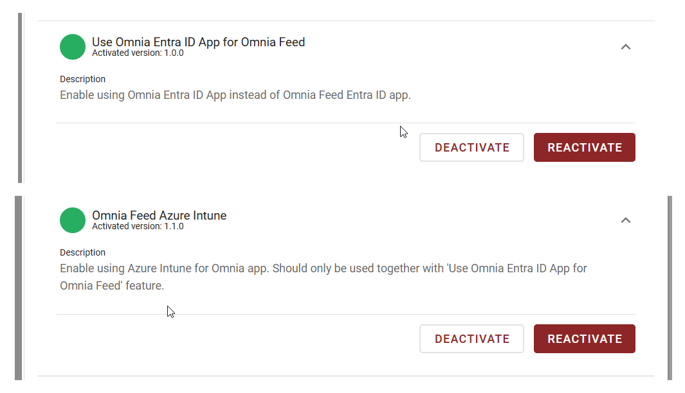

Release 7.12
============
Omnia Feed 7.12 introduces support for authentication through the shared Omnia Entra ID app, improved accessibility, an updated technical platform, and a simplified architecture for more efficient notification delivery and feed retrieval.

.. note::

  Omnia Feed 7.12 supports authentication through both the **Omnia** and **Omnia Feed 2** Entra ID apps. From version 7.13, we plan to support only the Omnia app. We therefore recommend enabling the feature and switching to the Omnia app already in 7.12.

**Customers using Intune** should review and update their rules and policies to include the Omnia app, ensuring they do not apply only to the Omnia Feed 2 app.

Once the Omnia Feed 2 app is no longer used for authentication, its consent can be revoked.

Simplified architecture
-----------------------
Omnia Feed now consists of just two components: the mobile app and the extension. The separate backend has been removed, eliminating the need for backend synchronization and allowing notifications for newly published pages, likes, and comments to reach users much faster.

Authentication using the shared Omnia Entra ID app
--------------------------------------------------
The mobile app can now use the general Omnia Entra ID app for authentication instead of the separate Omnia Feed 2 app. This option requires feature activation.

Improved accessibility (WCAG)
-----------------------------
This release includes several WCAG improvements to make the mobile app easier to use with screen readers and external keyboards:

- **Modals:** Screen readers now announce modal names when opened, and VoiceOver focus correctly moves to the first menu item in the comment reaction modal.
- **Keyboard navigation:** Improved external-keyboard detection, clearer focus indicators for tabs and navigation buttons, and more consistent focus placement after actions.
- **Tabs and settings:** Improved screen reader announcements and focus behavior when switching tabs and navigating the Settings screen.
- **Content and layouts:** Improved accessibility for rich text, Column and Row layout blocks, and embedded web content.

Updated technical platform
--------------------------
The Omnia Feed extension has been prepared to use the Expo framework, and its underlying technical platform has been updated.
