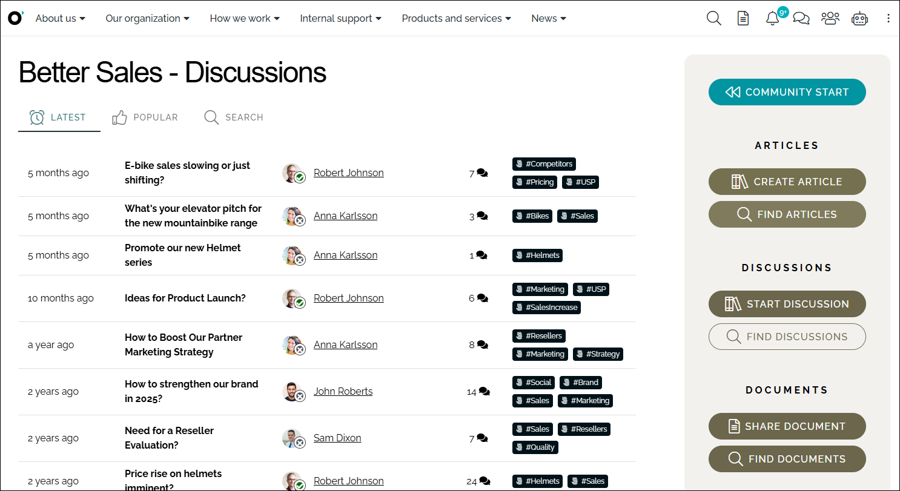
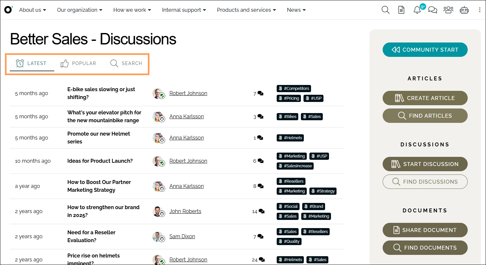
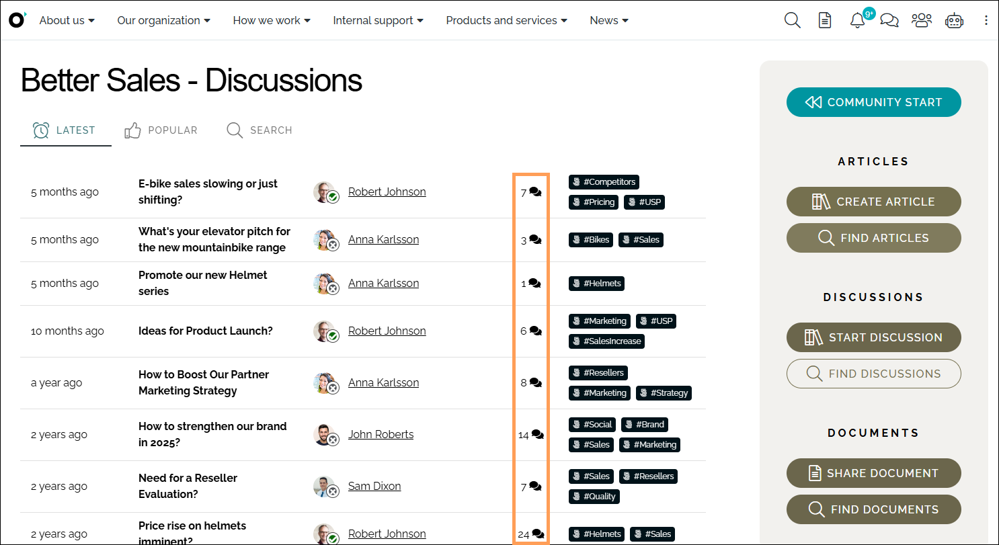
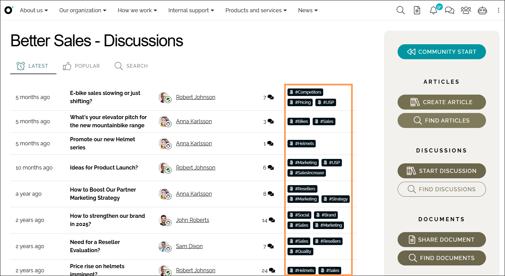
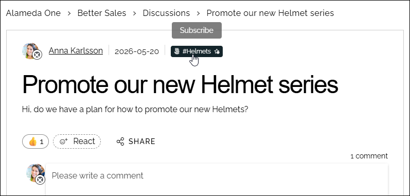

Discussions
=============================

Discussions can be set up other ways but in the default setup, any colleague can start a discussion and any colleague can participate in any discussion.

All discussions in this community are listed on the discussions start page. It can look like this:

The list can be sorted on Latest, Popular or Most Commented. Popular counts the number of likes for each discussion. You can also search for discussions and comments.

The Latest list is sorted on when the last comments was added, so the most active discussion is at the top. Also note that the number of comments is shown for every article, here:

To the right, tags for the discussions are shown. 

In the discussion and article, you can click a tag to subscribe to that tag.

**Note!** Tags are global, so when you subscribe to a tag, you subscribe to that tag in discussions and knowledge articles in ALL active communities in the tenant.

.. toctree::
   :titlesonly:

   start-discussion/index
   participate-in-discussions/index
   like-share-bestreply/index
