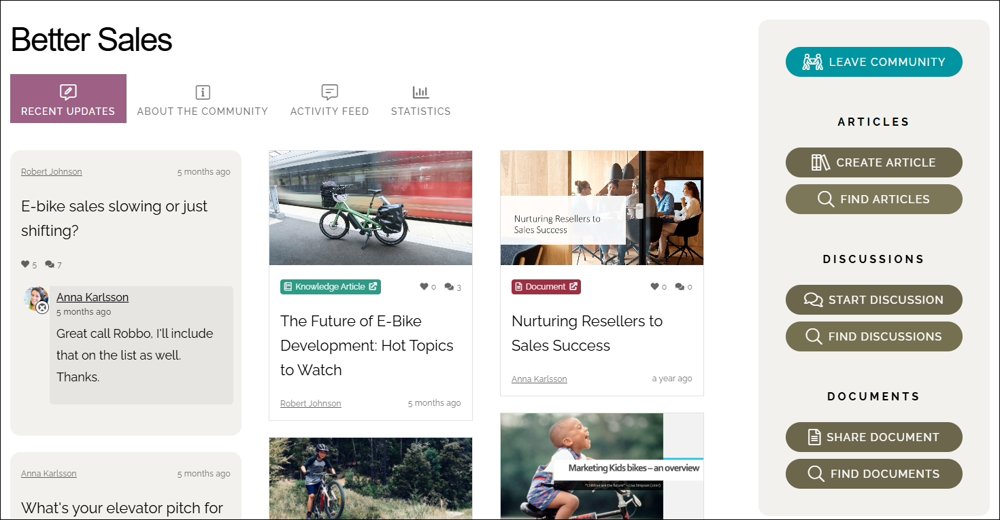

Using communities
===================

In this part of the documentation you will find information on how to use communities, both editors options and from an end user's point of view. 

Prerequisite: The tenant feature "Communities" must be active for any community options to be available. Web content management features must also be active for communities to work.

A community can be set up in different ways. Here's an example of a community start page:

This is how a community start page can look when set up with knowledge articles, discussions and subscriptions. If the community is set up some other way, the start page will be different.

Top contributors can also be displayed, if the community is set up to use activity tracking and activity points.

You can click on any post in the list to go to that discussion, comment or knowledge article. Regarding top contributors, or any other people list that may be available, you can click the name to see more information about that colleague. The user profile card will then open, if it's used within your organization. If it's not, the colleague's delve page will be displayed.

Select page for more information:

.. toctree::
   :titlesonly:

   discussions/index
   knowledge-articles/index
   subscriptions/subscribe/index
   settings/index

