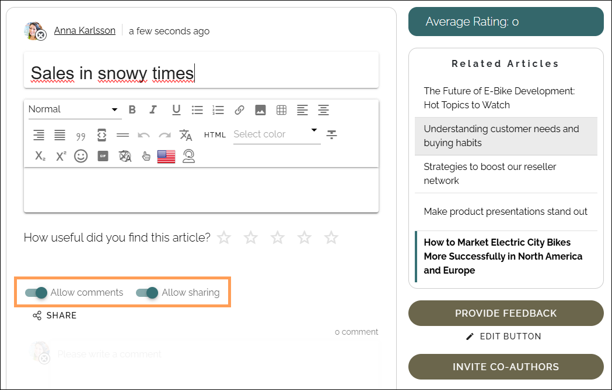
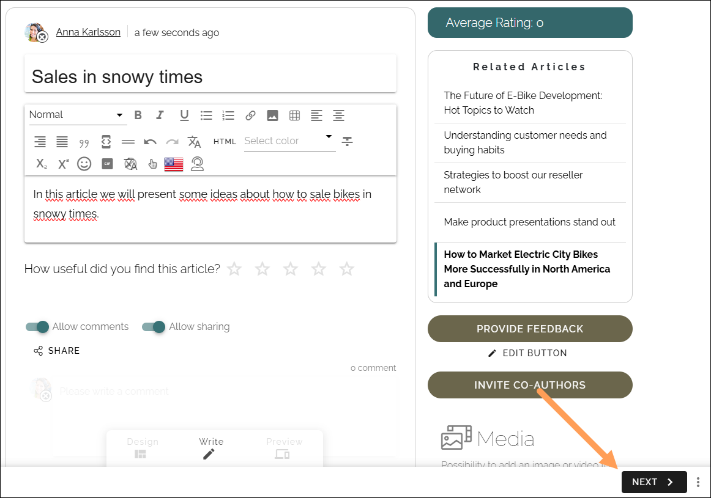
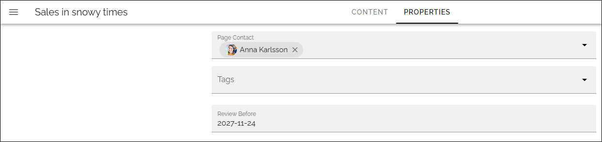
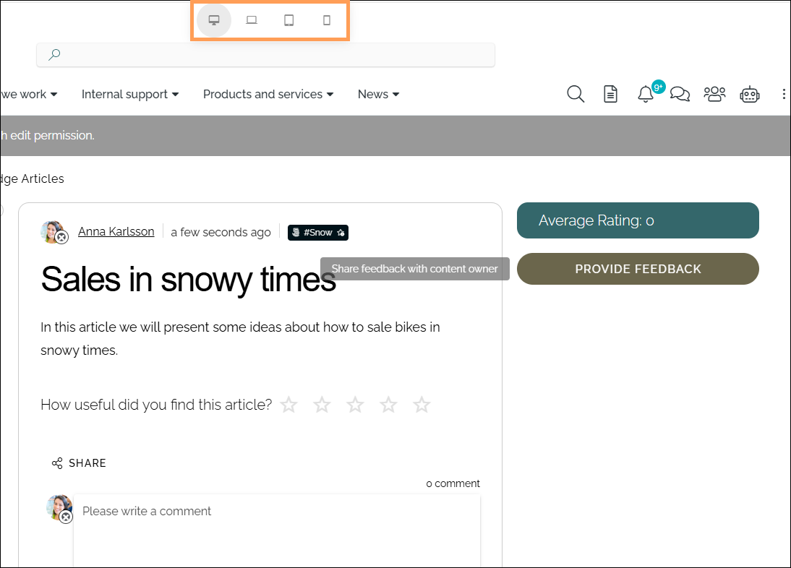
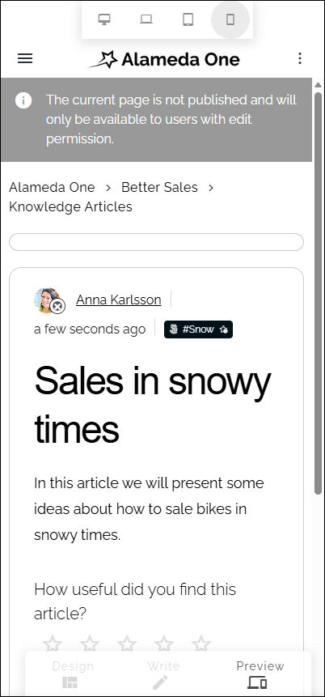
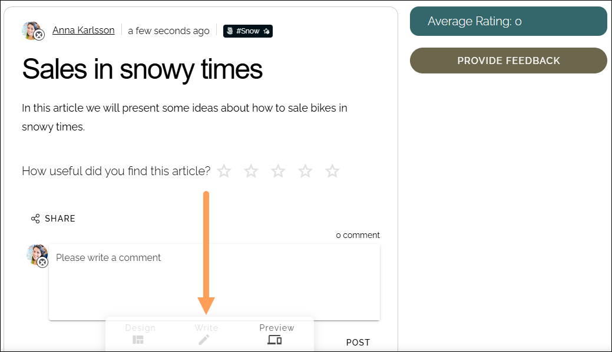
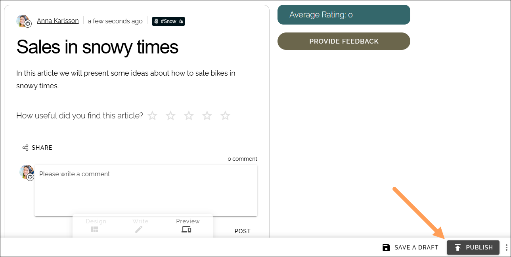

Create a knowledge article
============================

Communities can be set up in several ways but in the default setup, all users of the tenant can create and edit knowledge articles. 

This is a simple walk through on how to create a knowledge article. The same permissions apply as for authors of publishing pages, meaning all options in Write mode are available.

To create a knowledge article in a community, do the following:

1. Click "CREATE ARTICLE" (or something similar).

.. image:: create-article-create-712.png

2. Type a title for the article. The title will be used for the name of the page, for example shown on the start page for knowledge articles, and as the heading for the page. You can edit the title later if needed.

As the knowledge article actually is a page, an Url is automatically created.

3. Click "CREATE".
4. The next step is to add content to the page.

What you actually can add depends on the template. Here's a common one:

.. image:: create-article-5-712.png

5. Add content, the same way as you would any other page. 

See this page for more information: :doc:`Create a page </pages/create-page/index>`

To add images, you use the media picker. Find more information here: :doc:`The media picker </general-assets/media-picker/index>`

You never have to add content in all blocks if you don't want to - if you don't add media or text in a block, the block is normally not shown for readers.

6. Edit the heading if it should not be the same as the page name.
7. At the bottom of the page you can decide if you allow likes and comments for the page, which you normally should do (meaning no changes are needed).

Other areas that may be available, as Ratings and Related content, that are part of the template we use here; you should not do anything with them, or you even are not allowed to, depending on how the template is set up. They are there to be displayed for readers.

When you're done adding content:

8: Click "NEXT".

Here you can add the page's properties and tags There can be more properties here depending on how the template is set up.

9. Add or remove tags in the field, and for other properties as needed.

Remember, if you create a new tag, it becomes available for tagging in all communities in the tenant.

10. When you're done here, click NEXT in the low right corner.

As the last step before publishing the knowledge page, you can preview it to see how it will look for readers.

11. Use the icons at the top to preview the page in different sizes. 

Here's an example with a preview for mobile phone:

12. If you want to edit anything before publishing, click Write here:

13. To publish the knowledge article, click PUBLISH.

Concerning all options for publishing (for example information on how to schedule publishing, if that is available), see: :doc:`Publish page changes </pages/publish-page-changes/index>`
