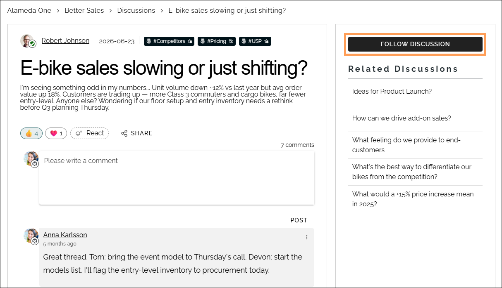
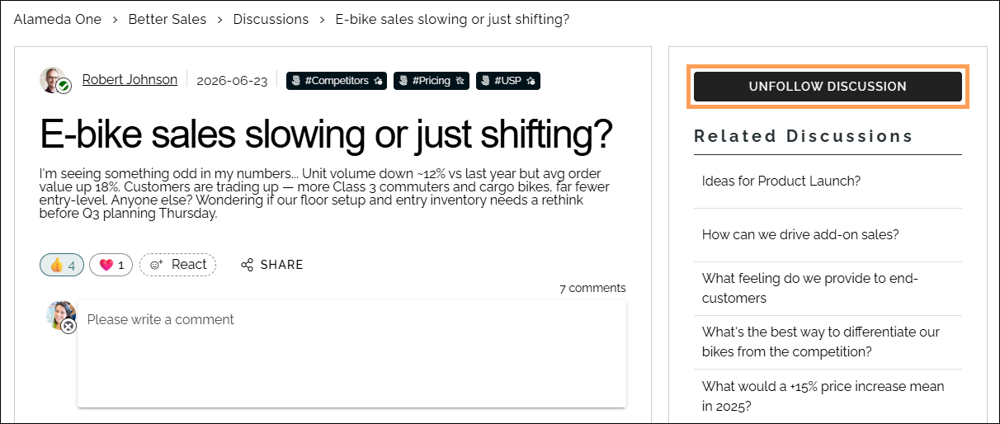
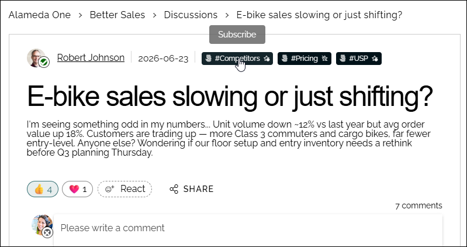
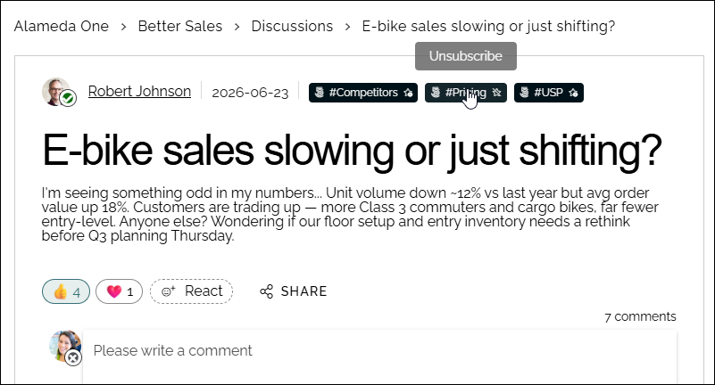

How to subscribe in a community
====================================

You can subscribe on all levels of a community.

You can subscribe to all activities in the community, all knowledge articles and all discussions in a community. The text on the button can be called something else, for example "Follow/Unfollow" as seen in images below.

Subscribe to a knowledge article or a discussion
**************************************************
To subscribe to a knowledge article or a discussion, do the following:

1. Go to the knowledge article or discussion.
2. Click SUBSCRIBE (FOLLOW).

If you already are subscribing, the option says UNSUBCRIBE (UNFOLLOW) instead and you can click it to unsubscribe.

You can also unsubscribe in the My subscriptions list.

Subscribe to tags
******************
Tags are global for the whole community, so if you subscribe to a tag, you subscribe to all activities in all knowledge articles and all discussions tagged that way. It can be quite a lot. 

When you point at a tag, you see if you subscribe to it already. It then says "Unsubscribe", see below.

To subscribe to a tag, just click it when you see it listed, as here:

You can also unsubscribe to a tag when you see it. 

You can also unsubscribe to a tag in My subscriptions.

